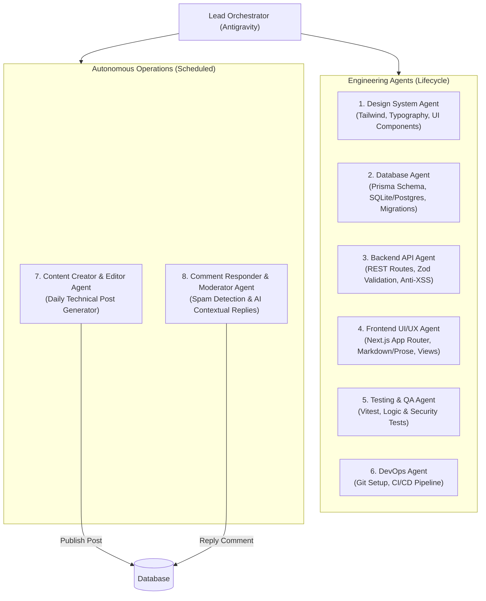

# Antigravity Multi-Agent Blog 🚀

A modern, production-grade, full-stack blog application engineered and maintained by an **autonomous Multi-Agent System** using **Google Antigravity**, **Next.js 15 (App Router)**, **React 19**, **Tailwind CSS**, and **Prisma ORM**.

---

## 📋 Overview

This project showcases how specialized AI subagents can collaborate across the entire software development and operations lifecycle:
1. **Engineering Lifecycle**: UI Design Tokens, Database Architecture, Secure Backend APIs, Responsive Frontend, Unit Testing, and DevOps/CI-CD.
2. **Autonomous Operations**: Scheduled daily technical article creation and automated reader comment moderation/replying.

---

## 🏛️ System Architecture



---

## 🤖 The Multi-Agent Ecosystem

| Agent | Scope & Domain | Execution Type | Deliverables |
|---|---|---|---|
| **Design System Agent** | UI/UX design tokens & atomic components | On-demand | `src/components/ui/*`, `tailwind.config.ts`, `globals.css` |
| **Database Agent** | Relational schema modeling & migrations | On-demand | `prisma/schema.prisma`, `prisma/seed.ts`, `src/lib/db.ts` |
| **Backend API Agent** | Business logic, API endpoints, Zod validation | On-demand | `src/app/api/*`, `src/lib/validations.ts` |
| **Frontend UI/UX Agent** | Server/Client components, Markdown rendering | On-demand | `src/app/page.tsx`, `src/app/posts/[slug]/page.tsx`, `src/components/blog/*` |
| **Unit Testing Agent** | Vitest test suites & security verification | CI / Pre-commit | `tests/validations.test.ts`, `tests/markdown.test.ts` (100% pass) |
| **DevOps Agent** | Git version control & GitHub Actions CI/CD | Push / Pull Request | `.github/workflows/ci.yml` |
| **Content Creator Agent** | Generates in-depth tech articles from backlog | Scheduled (`0 8 * * *`) | `scripts/daily-content.ts`, `content/backlog.json` |
| **Comment Responder Agent** | Moderates spam and publishes contextual replies | Scheduled (`0 * * * *`) | `scripts/reply-comments.ts` |

---

## 🛠️ Tech Stack

- **Framework**: [Next.js 15](https://nextjs.org/) (App Router, React Server Components)
- **Library**: [React 19](https://react.dev/)
- **Styling**: [Tailwind CSS](https://tailwindcss.com/) + `@tailwindcss/typography`
- **Database & ORM**: [Prisma ORM](https://www.prisma.io/) with SQLite (zero-config, portable) or PostgreSQL
- **Data Validation & Sanitization**: [Zod](https://zod.dev/)
- **Markdown Parser**: [Marked](https://marked.js.org/)
- **Testing**: [Vitest](https://vitest.dev/)
- **CI/CD**: GitHub Actions

---

## 📁 Project Directory Structure

```
d:/c/blog/
├── .github/
│   └── workflows/
│       └── ci.yml                 # GitHub Actions CI pipeline
├── content/
│   └── backlog.json               # Topic ideas backlog for Content Agent
├── docs/
│   ├── blog_draft_v1.md           # Multi-agent conceptual specifications
│   └── multi_agent_blog_implementation_plan.md
├── prisma/
│   ├── schema.prisma              # Database schema (Post, Tag, Comment)
│   └── seed.ts                    # Initial demo articles and comments
├── public/
├── scripts/
│   ├── daily-content.ts           # Autonomous Content Creator & Editor Agent runner
│   └── reply-comments.ts          # Autonomous Comment Responder & Moderator runner
├── src/
│   ├── app/
│   │   ├── api/
│   │   │   ├── comments/route.ts  # Comment submission & moderation endpoint
│   │   │   └── posts/route.ts     # Post listing & creation endpoint
│   │   ├── globals.css            # Design tokens & color system
│   │   ├── layout.tsx             # Root layout with header/footer
│   │   ├── page.tsx               # Homepage with featured posts & search
│   │   └── posts/
│   │       └── [slug]/page.tsx    # Article reader & discussion section
│   ├── components/
│   │   ├── blog/
│   │   │   ├── CommentSection.tsx # Interactive discussion & nested thread replies
│   │   │   ├── Footer.tsx         # Site footer
│   │   │   ├── Navbar.tsx         # Sticky navigation bar
│   │   │   └── PostCard.tsx       # Article preview card
│   │   └── ui/                    # Atomic design system components
│   │       ├── badge.tsx
│   │       ├── button.tsx
│   │       ├── card.tsx
│   │       ├── input.tsx
│   │       └── textarea.tsx
│   └── lib/
│       ├── db.ts                  # Prisma Client singleton
│       ├── markdown.ts            # Markdown parsing & reading time estimation
│       └── validations.ts         # Zod schemas & anti-XSS protection
├── tests/
│   ├── markdown.test.ts           # Unit tests for slug & markdown parsing
│   └── validations.test.ts        # Unit tests for comment & post validation
├── AGENTS.md                      # System prompts & Antigravity operational guide
├── package.json
├── tailwind.config.ts
├── tsconfig.json
└── vitest.config.ts
```

---

## 🚀 Getting Started

### 1. Prerequisites
- [Node.js](https://nodejs.org/) v20 or higher (v24 supported)
- [Git](https://git-scm.com/)

### 2. Installation
Clone the repository (or navigate into the project directory):
```powershell
cd d:\c\blog
npm.cmd install
```

### 3. Database Setup & Seeding
Initialize the SQLite database and seed initial demo content:
```powershell
# Push Prisma schema to SQLite
npm.cmd run db:push

# Seed initial articles and discussion threads
npm.cmd run db:seed
```

### 4. Running the Development Server
```powershell
npm.cmd run dev
```
Open [http://localhost:3000](http://localhost:3000) in your browser to view the blog.

---

## 🧪 Running Unit Tests

Unit tests are written with Vitest and test business logic, slug generation, reading time calculations, and anti-XSS protection:
```powershell
npm.cmd run test
```

To run a production build verification:
```powershell
npm.cmd run build
```

---

## 🤖 Running Autonomous Operational Agents

### A. Content Creator & Editor Agent
Reads the next available topic from `content/backlog.json`, composes an in-depth technical post with code snippets, conducts an editorial review, saves it to the database, and flags the topic as `PUBLISHED`:
```powershell
npm.cmd run agent:content
```

### B. Comment Responder & Moderation Agent
Scans the database for unanswered reader comments, filters potential spam, analyzes question context, and publishes an author reply with the badge `Author Bot`:
```powershell
npm.cmd run agent:comments
```

### C. Antigravity Scheduling (`/schedule`)
You can automate these agents inside Antigravity by scheduling cron triggers:
- **Daily Content Generation (Every day at 08:00 AM)**:
  ```text
  /schedule CronExpression="0 8 * * *" Prompt="Execute npm.cmd run agent:content and summarize newly published article"
  ```
- **Hourly Comment Checking (Every hour)**:
  ```text
  /schedule CronExpression="0 * * * *" Prompt="Execute npm.cmd run agent:comments and moderate pending reader comments"
  ```

---

## 🌐 Deployment to GitHub & Cloud Hosting

### 1. Connecting to GitHub
If you haven't linked this local repository to GitHub yet:
```powershell
# Add your GitHub remote
git remote add origin https://github.com/<your-username>/<your-repo-name>.git

# Push to main branch
git push -u origin main
```

### 2. CI/CD Pipeline
Every push and pull request to `main` automatically triggers the GitHub Actions workflow [`.github/workflows/ci.yml`](.github/workflows/ci.yml) to run dependency auditing, Prisma generation, Vitest test suites, and Next.js production builds.

### 3. Deploying to Vercel
1. Import your GitHub repository into [Vercel](https://vercel.com).
2. Set the Environment Variable `DATABASE_URL` (for serverless environments, switch to PostgreSQL / Supabase / Neon or use Turso / LibSQL).
3. Click **Deploy**.

---

## 📄 Documentation Links

- **[Multi-Agent Architecture Guide](docs/blog_draft_v1.md)**: Conceptual breakdown and detailed agent responsibilities.
- **[Agent Prompts & Operations](AGENTS.md)**: Exact system prompts and instructions for Antigravity subagents.
- **[Implementation Walkthrough](C:\Users\cahya.satria\.gemini\antigravity\brain\54ffac99-5f7e-444b-9f55-c0cf942ab34f\walkthrough.md)**: Full verification report and execution logs.

---

## 📝 License
This project is open-source and available under the [MIT License](LICENSE).
