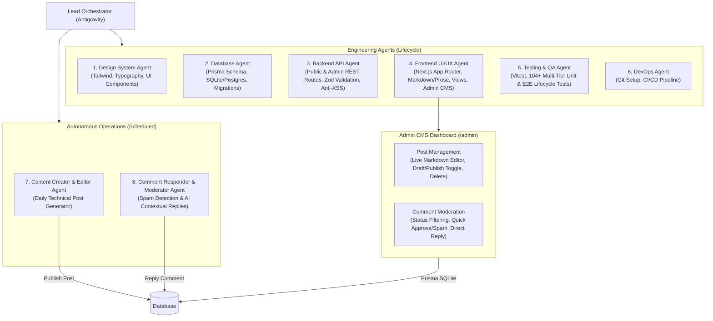

# Antigravity Multi-Agent Blog 🚀

A modern, production-grade, full-stack blog application engineered and maintained by an **autonomous Multi-Agent System** using **Google Antigravity**, **Next.js 15 (App Router)**, **React 19**, **Tailwind CSS**, and **Prisma ORM**.

Now equipped with a comprehensive **Admin CMS Dashboard** for visual post management, live Markdown authoring, and reader comment moderation.

---

## 📋 Overview

This project showcases how specialized AI subagents can collaborate across the entire software development and operations lifecycle:
1. **Engineering Lifecycle**: UI Design Tokens, Database Architecture, Secure Backend APIs, Responsive Frontend, Unit/Integration Testing, and DevOps/CI-CD.
2. **Admin CMS Suite**: Internal web-based dashboard (`/admin`) for article authoring with live preview, publishing controls, and comment moderation with threaded replies.
3. **Autonomous Operations**: Scheduled daily technical article creation and automated reader comment moderation/replying.

---

## 🏛️ System Architecture



---

## 🤖 The Multi-Agent Ecosystem

| Agent | Scope & Domain | Execution Type | Deliverables |
|---|---|---|---|
| **Design System Agent** | UI/UX design tokens & atomic components | On-demand | `src/components/ui/*`, `tailwind.config.ts`, `globals.css` |
| **Database Agent** | Relational schema modeling & migrations | On-demand | `prisma/schema.prisma`, `prisma/seed.ts`, `src/lib/db.ts` |
| **Backend API Agent** | Business logic, API endpoints, Zod validation | On-demand | `src/app/api/*`, `src/app/api/admin/*`, `src/lib/validations.ts` |
| **Frontend UI/UX Agent** | Public blog & Admin CMS (`/admin`), Live Preview | On-demand | `src/app/page.tsx`, `src/app/posts/[slug]/page.tsx`, `src/app/admin/*`, `src/components/admin/*` |
| **Unit Testing Agent** | Vitest test suites & lifecycle verification | CI / Pre-commit | `tests/*` (**104/104 tests passing 100%**) |
| **DevOps Agent** | Git version control & GitHub Actions CI/CD | Push / Pull Request | `.github/workflows/ci.yml` |
| **Content Creator Agent** | Generates in-depth tech articles from backlog | Scheduled (`0 8 * * *`) | `scripts/daily-content.ts`, `content/backlog.json` |
| **Comment Responder Agent** | Moderates spam and publishes contextual replies | Scheduled (`0 * * * *`) | `scripts/reply-comments.ts` |

---

## ⚡ Features & Capabilities

### 1. Reader Blog Interface
- **Modern Minimalist UI**: Clean design system built with Tailwind CSS and `@tailwindcss/typography`.
- **Dynamic Prose Renderer**: Native markdown parsing with custom syntax highlighting and reading time indicator.
- **Nested Discussions**: Interactive comment section with direct replies and author badges.

### 2. Admin CMS Dashboard (`/admin`)
- **Direct Local Access**: Integrated internal route at `/admin` accessible with unified tabs.
- **Post Lifecycle Management**:
  - Full CRUD: Create, read, update, and delete blog posts.
  - **Interactive Live Markdown Preview**: Split-pane or toggleable real-time preview of formatted text and code blocks.
  - **Publish Status Toggle**: Switch between `Draft` and `Published` instantly.
  - **SEO & Metadata**: Auto slug generation from title, reading time estimation, and tag management.
- **Comment Moderation Center**:
  - Filter by status: `PENDING`, `APPROVED`, `SPAM`.
  - Quick action buttons: **Approve**, **Mark as Spam**, **Delete**.
  - **Direct Author Reply**: Respond directly to readers with the `isAuthorReply: true` badge.

### 3. Autonomous AI Agents
- **Daily Content Creator**: Autonomous script creating structured technical articles from backlog.
- **Smart Comment Responder**: Automated contextual replier and spam scanner.

---

## 🛠️ Tech Stack

- **Framework**: [Next.js 15](https://nextjs.org/) (App Router, React Server Components, Server Actions)
- **Library**: [React 19](https://react.dev/)
- **Styling**: [Tailwind CSS](https://tailwindcss.com/) + `@tailwindcss/typography`
- **Database & ORM**: [Prisma ORM](https://www.prisma.io/) with SQLite (`prisma/dev.db`) or PostgreSQL
- **Data Validation & Sanitization**: [Zod](https://zod.dev/)
- **Icons**: [Lucide React](https://lucide.dev/)
- **Markdown Parser**: [Marked](https://marked.js.org/)
- **Testing**: [Vitest](https://vitest.dev/) (104 automated test cases)
- **CI/CD**: GitHub Actions

---

## 📁 Project Directory Structure

```
blog/
├── .github/
│   └── workflows/
│       └── ci.yml                 # GitHub Actions CI pipeline
├── content/
│   └── backlog.json               # Topic backlog for Content Creator Agent
├── docs/
│   ├── blog_draft_v1.md           # Multi-agent conceptual specifications
│   └── multi_agent_blog_implementation_plan.md
├── prisma/
│   ├── schema.prisma              # Database schema (Post, Tag, PostTag, Comment)
│   └── seed.ts                    # Initial demo articles and comments
├── scripts/
│   ├── daily-content.ts           # Content Creator & Editor Agent runner
│   └── reply-comments.ts          # Comment Responder & Moderator Agent runner
├── src/
│   ├── app/
│   │   ├── admin/
│   │   │   ├── layout.tsx         # Dedicated Admin Dashboard layout
│   │   │   └── page.tsx           # Admin Hub (Post List, Post Editor, Comments)
│   │   ├── api/
│   │   │   ├── admin/
│   │   │   │   ├── comments/
│   │   │   │   │   ├── [id]/
│   │   │   │   │   │   ├── reply/route.ts  # Direct author reply endpoint
│   │   │   │   │   │   └── route.ts        # Approve, spam flag, delete comment
│   │   │   │   │   └── route.ts            # Admin list comments with status filters
│   │   │   │   └── posts/
│   │   │   │       ├── [id]/
│   │   │   │       │   ├── publish/route.ts # Toggle publish/draft status
│   │   │   │       │   └── route.ts         # Update & delete post
│   │   │   │       └── route.ts             # Admin list & create post
│   │   │   ├── comments/route.ts  # Public comment submission endpoint
│   │   │   └── posts/route.ts     # Public post listing endpoint
│   │   ├── globals.css            # Tailwind & CSS variable tokens
│   │   ├── layout.tsx             # Public layout with navigation
│   │   ├── page.tsx               # Homepage with featured articles
│   │   └── posts/
│   │       └── [slug]/page.tsx    # Article reader & discussion section
│   ├── components/
│   │   ├── admin/                 # Admin CMS Components
│   │   │   ├── CommentList.tsx    # Comment moderation list & quick actions
│   │   │   ├── CommentReplyModal.tsx # Direct author reply modal
│   │   │   ├── PostEditor.tsx     # Markdown editor with live preview
│   │   │   └── PostList.tsx       # Post management table & publish toggle
│   │   ├── blog/                  # Public Blog Components
│   │   │   ├── CommentSection.tsx # Interactive reader discussion
│   │   │   ├── Footer.tsx         # Site footer
│   │   │   ├── Navbar.tsx         # Sticky navigation with Admin Hub link
│   │   │   └── PostCard.tsx       # Post summary card
│   │   └── ui/                    # Reusable atomic UI elements
│   │       ├── badge.tsx
│   │       ├── button.tsx
│   │       ├── card.tsx
│   │       ├── input.tsx
│   │       └── textarea.tsx
│   └── lib/
│       ├── db.ts                  # Prisma Client singleton
│       ├── markdown.ts            # Markdown parsing & reading time estimation
│       └── validations.ts         # Zod schemas (Post, Comment, Admin Actions)
├── tests/
│   ├── admin-comments-api.test.ts # Admin comment moderation API tests (21 tests)
│   ├── admin-integration.test.ts  # Real SQLite DB lifecycle & scenario tests (15 tests)
│   ├── admin-posts-api.test.ts     # Admin post management API tests (26 tests)
│   ├── admin-validations.test.ts  # Admin Zod validation schemas (33 tests)
│   ├── markdown.test.ts           # Slug & markdown parser tests (3 tests)
│   └── validations.test.ts        # Public validation tests (6 tests)
├── AGENTS.md                      # Multi-agent system prompts & cron schedules
├── package.json
├── tailwind.config.ts
├── tsconfig.json
└── vitest.config.ts
```

---

## 🚀 Getting Started

### 1. Prerequisites
- [Node.js](https://nodejs.org/) v20 or higher (v24 tested & supported)
- [Git](https://git-scm.com/)

### 2. Installation
```powershell
cd d:\c\blog
npm.cmd install
```

### 3. Database Setup & Seeding
```powershell
# Push Prisma schema to SQLite
npm.cmd run db:push

# Seed demo articles and discussion threads
npm.cmd run db:seed
```

### 4. Running the Application
```powershell
npm.cmd run dev
```
- **Public Blog**: [http://localhost:3000](http://localhost:3000)
- **Admin CMS Dashboard**: [http://localhost:3000/admin](http://localhost:3000/admin)

---

## 🖥️ Using the Admin CMS Dashboard

Access `http://localhost:3000/admin` or click **"Admin Hub"** in the navigation bar:

1. **Manage Posts**:
   - View all articles with their current status (`Draft` or `Published`).
   - Click **"Artikel Baru"** to open the post editor with live split-screen Markdown preview.
   - Click the status badge to toggle between `Draft` and `Published` instantly.
   - Edit existing articles or delete unwanted ones.
2. **Moderate Comments**:
   - Filter comments by **Semua**, **Pending**, **Approved**, or **Spam**.
   - One-click **Setujui** (Approve) or **Tandai Spam** (Spam).
   - Click **Balas** to open the reply modal and reply directly to the reader as the Author/Bot.

---

## 🧪 Automated Testing & Quality Assurance

The application features **104 automated tests** across 6 test suites verifying input validation, route security, and real SQLite database lifecycles:

```powershell
npm.cmd run test
```

Test coverage includes:
- **`tests/admin-validations.test.ts` (33 tests)**: Post creation, slug formatting, update payloads, comment status changes, and author replies.
- **`tests/admin-posts-api.test.ts` (26 tests)**: Admin post CRUD, duplicate slug rejection, tag synchronization, and publish toggling.
- **`tests/admin-comments-api.test.ts` (21 tests)**: Comment status transitions, deletion, and threaded author replies.
- **`tests/admin-integration.test.ts` (15 tests)**: Real SQLite DB constraints, cascade deletions, and end-to-end user workflows.
- **`tests/validations.test.ts` (6 tests)**: Public input sanitization and anti-XSS injection protection.
- **`tests/markdown.test.ts` (3 tests)**: Reading time calculation and markdown-to-HTML rendering.

To verify the production build:
```powershell
npm.cmd run build
```

---

## 🤖 Running Autonomous Operational Agents

### A. Content Creator & Editor Agent
Reads the next available topic from `content/backlog.json`, composes an in-depth technical post with code snippets, conducts an editorial review, saves it to the database, and flags the topic as `PUBLISHED`:
```powershell
npm.cmd run agent:content
```

### B. Comment Responder & Moderation Agent
Scans the database for unanswered reader comments, filters potential spam, analyzes question context, and publishes an author reply with the badge `Author Bot`:
```powershell
npm.cmd run agent:comments
```

### C. Antigravity Scheduling (`/schedule`)
Automate these agents inside Antigravity by scheduling cron triggers:
- **Daily Content Generation (Every day at 08:00 AM)**:
  ```text
  /schedule CronExpression="0 8 * * *" Prompt="Execute npm.cmd run agent:content and summarize newly published article"
  ```
- **Hourly Comment Checking (Every hour)**:
  ```text
  /schedule CronExpression="0 * * * *" Prompt="Execute npm.cmd run agent:comments and moderate pending reader comments"
  ```

---

## 🌐 Deployment to GitHub & Cloud Hosting

### 1. Connecting to GitHub
```powershell
# Add your GitHub remote
git remote add origin https://github.com/<your-username>/<your-repo-name>.git

# Push to main branch
git push -u origin main
```

### 2. CI/CD Pipeline
Every push and pull request to `main` automatically triggers [`.github/workflows/ci.yml`](.github/workflows/ci.yml) to run dependency auditing, Prisma generation, Vitest test suites (104 tests), and Next.js production builds.

### 3. Deploying to Vercel / Railway
1. Connect your repository to [Vercel](https://vercel.com) or [Railway](https://railway.app).
2. Set `DATABASE_URL` (for serverless hosting, use PostgreSQL / Supabase / Neon or Turso / LibSQL).
3. Deploy!

---

## 📄 Documentation Links

- **[Multi-Agent Architecture Guide](docs/blog_draft_v1.md)**: Conceptual breakdown and detailed agent responsibilities.
- **[Agent Prompts & Operations](AGENTS.md)**: Exact system prompts and instructions for Antigravity subagents.
- **[Implementation Walkthrough](C:\Users\cahya.satria\.gemini\antigravity\brain\54ffac99-5f7e-444b-9f55-c0cf942ab34f\walkthrough.md)**: Full verification report and execution logs.

---

## 📝 License
This project is open-source and available under the [MIT License](LICENSE).
