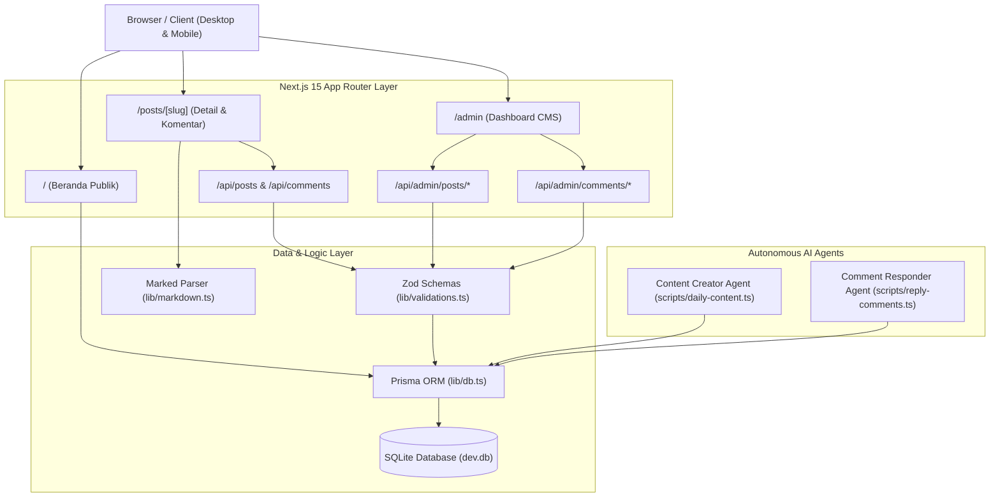

# Dokumentasi Teknis Repositori (Repository Documentation)

Dokumen ini disusun oleh **Technical Writer Agent** untuk mencatat arsitektur sistem, skema basis data, spesifikasi API publik & admin, pustaka komponen, serta infrastruktur pengujian pada repositori **Antigravity Multi-Agent Blog**.

---

## 1. Spesifikasi Teknis & Arsitektur



---

## 2. Model Basis Data (Prisma ORM Schema)

Skema basis data dikelola menggunakan Prisma ORM (`prisma/schema.prisma`) dengan SQLite sebagai penyimpan data lokal:

### A. Model `Post`
Menyimpan seluruh artikel blog publik maupun draf internal.
- `id`: String (Primary Key, `@default(cuid())`)
- `title`: String
- `slug`: String (Unique, Indexed)
- `excerpt`: String
- `content`: String (Isi artikel dalam format Markdown)
- `coverImage`: String? (Opsional)
- `published`: Boolean (`@default(true)`)
- `likes`: Int (`@default(0)`) -> Akumulasi tanda suka / apresiasi pembaca
- `readingTime`: Int (`@default(3)`)
- `publishedAt`: DateTime (`@default(now())`, Indexed)
- `createdAt` & `updatedAt`: DateTime
- **Relasi**:
  - `tags`: Relasi Many-to-Many melalui `PostTag` (Cascade Delete)
  - `comments`: Relasi One-to-Many ke `Comment` (Cascade Delete)

### B. Model `Comment`
Menyimpan komentar publik, balasan bersarang (*threaded replies*), dan status kurasi.
- `id`: String (Primary Key, `@default(cuid())`)
- `postId`: String (Foreign Key ke `Post.id`, Cascade Delete, Indexed)
- `authorName`: String
- `authorEmail`: String (Tersimpan aman untuk kebutuhan verifikasi)
- `content`: String (Teks komentar yang telah divalidasi dan disanitasi)
- `status`: String (`@default("APPROVED")`, Indexed) -> Nilai: `APPROVED`, `PENDING`, `SPAM`
- `isAuthorReply`: Boolean (`@default(false)`) -> Penanda balasan resmi dari penulis/admin
- `parentId`: String? (Self-relation untuk mendukung balasan bertingkat / threading)
- `createdAt`: DateTime (`@default(now())`)

### C. Model `Tag` & `PostTag`
Mengelola kategorisasi artikel.
- `Tag`: `id`, `name` (Unique), `slug` (Unique).
- `PostTag`: Tabel perantara (`postId`, `tagId`) dengan composite primary key `@@id([postId, tagId])`.

### D. Model `Subscriber`
Menyimpan data pelanggan buletin teknis (newsletter).
- `id`: String (Primary Key, `@default(cuid())`)
- `email`: String (Unique, Indexed, Case-normalized)
- `active`: Boolean (`@default(true)`) -> Status keaktifan langganan
- `createdAt`: DateTime (`@default(now())`)

---

## 3. Spesifikasi API Endpoints

### A. API Publik

| Method | Endpoint | Deskripsi | Status Respon |
|---|---|---|---|
| `GET` | `/api/posts` | Mengambil seluruh artikel yang berstatus `published: true` | `200 OK` |
| `POST` | `/api/posts` | Membuat artikel baru melalui payload terstruktur | `201 Created` / `400 Bad Request` |
| `GET` | `/api/posts/[id]/like` | Mengambil jumlah total tanda suka artikel (by CUID atau slug) | `200 OK` / `404 Not Found` |
| `POST` | `/api/posts/[id]/like` | Menambahkan tanda suka secara atomik dengan proteksi rate limit | `200 OK` / `429 Too Many Requests` |
| `POST` | `/api/comments` | Mengirim komentar pembaca dengan filter spam otomatis | `201 Created` / `400 Bad Request` |
| `POST` | `/api/newsletter/subscribe` | Berlangganan newsletter dengan validasi Zod & deduplikasi idempoten | `200 OK` / `400 Bad Request` |
| `GET` | `/sitemap.xml` | Peta situs XML dinamis berstandar Sitemaps 0.9 (isolasi draf) | `200 OK (application/xml)` |
| `GET` | `/robots.txt` | Aturan perayapan mesin pencari (memblokir rute `/admin`) | `200 OK (text/plain)` |
| `GET` | `/feed.xml` | Sindikasi RSS 2.0 Feed lengkap dengan RFC 822 pubDate | `200 OK (application/xml)` |
| `GET` | `/opengraph-image` | Pembuat kartu sosial dinamis Satori untuk Beranda (1200x630) | `200 OK (image/png)` |
| `GET` | `/posts/[slug]/opengraph-image` | Pembuat kartu sosial dinamis Satori per artikel (1200x630) | `200 OK (image/png)` |

#### Format Payload Pembuatan Komentar Publik (`POST /api/comments`):
```json
{
  "postId": "cmw8kk0s90000t9iknligdif1",
  "authorName": "Budi Santoso",
  "authorEmail": "budi@example.com",
  "content": "Terima kasih atas penjelasan arsitektur multi-agent yang sangat gamblang!",
  "parentId": null
}
```

---

### B. API Dashboard Admin

| Method | Endpoint | Deskripsi | Akses |
|---|---|---|---|
| `GET` | `/api/admin/posts` | Mengambil seluruh artikel (termasuk draf) dengan pagination & status | Admin |
| `POST` | `/api/admin/posts` | Membuat artikel baru lengkap dengan tags dan kalkulasi waktu baca | Admin |
| `GET` | `/api/admin/posts/[id]` | Mengambil data lengkap artikel tertentu untuk form edit | Admin |
| `PUT` | `/api/admin/posts/[id]` | Memperbarui judul, slug, konten, tag, atau status artikel | Admin |
| `DELETE` | `/api/admin/posts/[id]` | Menghapus artikel beserta relasi komentar dan tag-nya | Admin |
| `PATCH` | `/api/admin/posts/[id]/publish` | Mengubah status publikasi secara instan (`published: true/false`) | Admin |
| `GET` | `/api/admin/comments` | Mengambil komentar dengan filter query parameter `?status=PENDING` | Admin |
| `PATCH` | `/api/admin/comments/[id]` | Memperbarui status komentar (`APPROVED` atau `SPAM`) | Admin |
| `DELETE` | `/api/admin/comments/[id]` | Menghapus komentar dari database | Admin |
| `POST` | `/api/admin/comments/[id]/reply`| Mengirim balasan langsung berstatus `isAuthorReply: true` | Admin |
| `GET` | `/api/admin/subscribers` | Mengambil daftar pelanggan newsletter dengan filter status dan pencarian | Admin |
| `PATCH` | `/api/admin/subscribers/[id]` | Mengubah status aktif/nonaktif langganan | Admin |
| `DELETE` | `/api/admin/subscribers/[id]` | Menghapus data pelanggan dari basis data | Admin |
| `POST` | `/api/admin/media/upload` | Mengunggah gambar multipart/form-data dengan validasi MIME, magic bytes, & anti-XSS SVG | Admin |
| `GET` | `/api/admin/media` | Mengambil seluruh berkas media lokal di `public/uploads` dengan filter `?search=...` | Admin |
| `GET` | `/api/admin/media/[id]` | Mengambil metadata spesifik satu berkas media (nama, URL, ukuran, tanggal unggah) | Admin |
| `DELETE` | `/api/admin/media/[id]` | Menghapus berkas media fisik dari disk secara aman (proteksi path traversal) | Admin |

---

## 4. Struktur Modul & Komponen Frontend

```text
public/
└── uploads/                       # Direktori penyimpanan lokal berkas media unggahan
src/
├── app/
│   ├── layout.tsx                 # Root HTML shell dengan Navbar dan Footer
│   ├── page.tsx                   # Server Component: Homepage publik & daftar postingan
│   ├── globals.css                # Konfigurasi Tailwind, CSS variable, dan tema warna
│   ├── posts/
│   │   └── [slug]/page.tsx        # Detail artikel dengan konversi Markdown & diskusi pembaca
│   └── admin/
│       ├── layout.tsx             # Shell antarmuka khusus admin
│       └── page.tsx               # Client Component: State management untuk tab artikel, moderasi, & media
├── components/
│   ├── ui/                        # Komponen atomik: Button, Badge, Card, Input, Textarea
│   ├── blog/                      # Komponen pembaca: PostCard, CommentSection, LikeButton, NewsletterForm
│   └── admin/                     # Komponen CMS: PostList, PostEditor, CommentList, SubscriberList, MediaLibrary, MediaDeleteModal, MediaSelectModal
└── lib/
    ├── db.ts                      # Singleton PrismaClient dengan isolasi hot-reload
    ├── markdown.ts                # Parser marked & fungsi penghitung waktu baca (WPM)
    ├── media.ts                   # Engine utilitas media: MIME whitelist, magic bytes, sanitasi SVG, & penamaan berkas
    ├── rate-limit.ts              # Sliding-window rate limiter in-memory
    └── validations.ts             # Schema validasi Zod untuk seluruh operasi data
```

---

## 5. Infrastruktur Pengujian (Testing Infrastructure)

Pengujian diotomatisasi menggunakan **Vitest** dan mencakup 17 berkas uji dengan total **313 test cases (100% lulus)**:

```powershell
npx.cmd vitest run
```

### Rincian Berkas Pengujian:
1. `tests/validations.test.ts` (6 tests):
   - Validasi komentar publik (nama minimal 2 karakter, format email valid).
   - Pencegahan XSS: Memblokir tag `<script>` berbahaya.
   - Validasi payload artikel baru dan integritas format slug URL.
2. `tests/admin-validations.test.ts` (33 tests):
   - Validasi skema admin: pembaharuan parsial post, validasi array tag, mutasi status komentar, dan balasan author.
3. `tests/admin-posts-api.test.ts` (26 tests):
   - Pengujian mock handler API post admin: CRUD, penolakan slug duplikat, dan sinkronisasi relasi tag.
4. `tests/admin-comments-api.test.ts` (21 tests):
   - Pengujian mock handler API komentar admin: filter status, transisi status `PENDING` -> `APPROVED` -> `SPAM`, dan verifikasi relasi balasan berstatus `isAuthorReply: true`.
5. `tests/admin-integration.test.ts` (15 tests):
   - Pengujian integrasi langsung terhadap database SQLite (`prisma/dev.db`):
     - Tier 1: Relasi database Many-to-Many (`PostTag`) dan One-to-Many (`Comment`).
     - Tier 2: Penegakan batasan unik (*Unique Constraints*) dan integritas referensial foreign key.
     - Tier 3: Transisi status publikasi bolak-balik (*Draft <-> Published*).
     - Tier 4: Skenario siklus hidup nyata (alur draf ke publikasi, alur moderasi komentar pembaca, pertahanan terhadap spam, dan penghapusan artikel bertingkat *cascade delete*).
6. `tests/markdown.test.ts` (3 tests):
   - Kalkulasi akurat estimasi waktu membaca artikel (200 kata per menit).
   - Pembuatan slug ramah SEO dari teks judul Indonesia.
   - Konversi Markdown ke HTML terformat.
7. `tests/auth.test.ts` (4 tests):
   - Verifikasi pembuatan token HMAC Web Crypto, verifikasi otentikasi session cookie, dan invalidasi logout.
8. `tests/seo.test.ts` (35 tests):
   - Resolusi base URL dinamis dan pembersihan trailing slash.
   - Format XML Sitemap dan kepatuhan isolasi draf (draf tidak terindeks).
   - Aturan direktif crawler robots.txt (pemblokiran rute admin).
   - Format RSS 2.0 Feed lengkap dengan penanggalan RFC 822.
   - Tag metadata Open Graph & Twitter Cards pada layout dasar dan halaman detail artikel.
9. `tests/likes-api.test.ts` (16 tests):
   - Penambahan suka secara atomik (`increment`) by ID atau slug.
   - Pembatasan laju (*sliding-window rate limiting*) dan respon HTTP 429 `Retry-After`.
   - Validasi keberadaan artikel dan penanganan error 404.
10. `tests/newsletter.test.ts` (13 tests):
    - Validasi format email Zod dan pembersihan whitespace/lowercase.
    - Pencegahan duplikasi email secara idempoten (status 200 dengan indikator `alreadySubscribed`).
    - Reaktivasi otomatis jika pelanggan berstatus non-aktif sebelumnya.
11. `tests/admin-subscribers.test.ts` (12 tests):
    - Pengambilan daftar pelanggan dengan filter status aktif/nonaktif dan pagination.
    - Toggle status keaktifan pelanggan newsletter oleh admin.
    - Penghapusan data pelanggan secara aman.
12. `tests/challenger-likes-stress.test.ts` (13 tests):
    - Pengujian stres konkurensi klik Like bertubi-tubi dan verifikasi debouncing.
13. `tests/challenger-newsletter-stress.test.ts` (22 tests):
    - Pengujian adversarial penanganan masukan email newsletter (Unicode, domain unik, payload panjang).
14. `tests/challenger-2-verification.test.ts` (17 tests):
    - Verifikasi empiris pembentukan kartu sosial pratinjau dinamis Satori OG Image.
15. `tests/admin-media-api.test.ts` (26 tests):
    - Pengujian endpoint upload berkas multipart, listing media dengan filter pencarian, dan penghapusan berkas fisik.
    - Verifikasi proteksi session admin dan penanganan berkas yang tidak ditemukan.
16. `tests/challenger-media-storage.test.ts` (36 tests):
    - Pengujian batas ekstrem penyimpanan berkas: directory traversal (`../`), null-byte injection, double-extension spoofing, berkas 0-byte, dan penulisan bersamaan.
17. `tests/challenger-media-security.test.ts` (15 tests):
    - Pengujian keamanan payload: inspeksi biner magic bytes (menolak file PHP/EXE berkedok PNG/JPG) dan sanitasi mendalam vektor SVG anti-XSS (`<script>`, event handler inline).

---

## 6. Alur Kerja Integrasi Berkelanjutan (CI/CD Pipeline)

Workflow GitHub Actions dikonfigurasi di `.github/workflows/ci.yml`. Setiap operasi `git push` atau `pull_request` pada branch `main` akan menjalankan langkah verifikasi otomatis:
1. **Checkout Repository**: Mengambil kode sumber terbaru.
2. **Setup Node.js**: Mempersiapkan lingkungan Node.js v22 dengan caching npm.
3. **Install Dependencies**: Menjalankan `npm ci` untuk instalasi deterministik.
4. **Generate Prisma Client**: Membangun client Prisma dari skema `schema.prisma`.
5. **Run Automated Tests**: Menjalankan `npm run test` (104 test cases).
6. **Build Application**: Menguji kompilasi produksi Next.js `npm run build`.

---

## 7. Pemeliharaan & Kontribusi

Untuk menambahkan fitur baru pada repositori ini:
1. Buat branch baru dari `main`: `git checkout -b fitur-baru`.
2. Jika ada perubahan skema database, modifikasi `prisma/schema.prisma` dan jalankan `npm.cmd run db:push`.
3. Tambahkan unit test baru pada folder `tests/`.
4. Pastikan semua pengujian lolos: `npm.cmd run test`.
5. Pastikan build berhasil: `npm.cmd run build`.
6. Lakukan commit dan ajukan Pull Request ke branch `main`.
