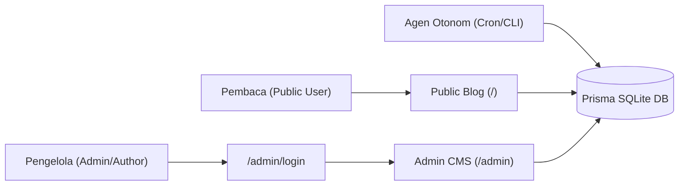
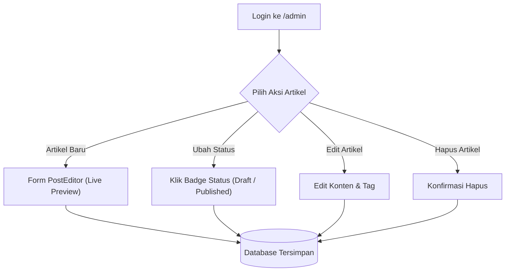

# Panduan Pengguna (User Guide) - Antigravity Multi-Agent Blog

Selamat datang di **Panduan Pengguna Antigravity Multi-Agent Blog**. Dokumen ini menyajikan instruksi lengkap mengenai cara menggunakan, mengelola, dan mengoperasikan aplikasi blog, baik dari perspektif pembaca umum maupun administrator/penulis blog.

---

## Daftar Isi
1. [Ikhtisar Aplikasi](#1-ikhtisar-aplikasi)
2. [Panduan Pembaca (Public Blog Interface)](#2-panduan-pembaca-public-blog-interface)
   - [Navigasi Beranda & Toggle Tema (Dark/Light Mode)](#navigasi-beranda--toggle-tema-darklight-mode)
   - [Pencarian Artikel & Filter Tag (Full-Text Search)](#pencarian-artikel--filter-tag-full-text-search)
   - [Membaca Artikel & Memberikan Apresiasi (Like / Clap Counter)](#membaca-artikel--memberikan-apresiasi-like--clap-counter)
   - [Berlangganan Buletin Teknis (Newsletter Subscription)](#berlangganan-buletin-teknis-newsletter-subscription)
   - [Sindikasi Konten & SEO (RSS Feed & Social Cards)](#sindikasi-konten--seo-rss-feed--social-cards)
   - [Berpartisipasi dalam Kolom Komentar](#berpartisipasi-dalam-kolom-komentar)
3. [Panduan Administrator (Admin CMS Dashboard)](#3-panduan-administrator-admin-cms-dashboard)
   - [Sistem Autentikasi & Login Admin](#sistem-autentikasi--login-admin)
   - [Manajemen Artikel (Post Management)](#manajemen-artikel-post-management)
   - [Editor Markdown & Live Preview](#editor-markdown--live-preview)
   - [Moderasi Komentar (Comment Moderation)](#moderasi-komentar-comment-moderation)
   - [Membalas Komentar sebagai Author](#membalas-komentar-sebagai-author)
   - [Manajemen Pelanggan Newsletter (Subscriber Management)](#manajemen-pelanggan-newsletter-subscriber-management)
   - [Keluar dari Sesi Admin (Logout)](#keluar-dari-sesi-admin-logout)
4. [Panduan Agen Operasional Mandiri (Autonomous Agents)](#4-panduan-agen-operasional-mandiri-autonomous-agents)
   - [Content Creator Agent (Posting Harian)](#content-creator-agent-posting-harian)
   - [Comment Responder Agent (Auto-Reply & Moderasi)](#comment-responder-agent-auto-reply--moderasi)
   - [Penjadwalan Otomatis di Antigravity](#penjadwalan-otomatis-di-antigravity)
5. [Troubleshooting & FAQ](#5-troubleshooting--faq)

---

## 1. Ikhtisar Aplikasi

Aplikasi ini adalah platform blog modern berbasis **Next.js 15 App Router**, **React 19**, **Tailwind CSS**, dan **Prisma ORM**. Platform ini mengintegrasikan ekosistem agen AI otonom untuk rekayasa perangkat lunak dan operasional harian, dilengkapi **Pencarian Full-Text**, **Toggle Dark/Light Mode**, dan **Sistem Autentikasi Admin Terproteksi**.



---

## 2. Panduan Pembaca (Public Blog Interface)

### Navigasi Beranda & Toggle Tema (Dark/Light Mode)
- Kunjungi `http://localhost:3000/`.
- **Toggle Tema (Dark / Light Mode)**:
  - Di sudut kanan atas pada Navbar, terdapat tombol ikon Matahari/Bulan.
  - Klik tombol tersebut untuk beralih antara mode gelap (*dark mode*) dan mode terang (*light mode*).
  - Pilihan tema Anda akan otomatis tersimpan di peramban (*localStorage*) sehingga tema tetap konsisten saat berpindah halaman.
- **Tautan Navigasi**: Terdapat tautan ke **Beranda**, tombol **Admin**, dan tautan ke repositori GitHub.

### Pencarian Artikel & Filter Tag (Full-Text Search)
Pada bagian atas beranda (*Hero Section*), tersedia kotak pencarian interaktif:
1. **Pencarian Kata Kunci**:
   - Ketikkan topik yang dicari (misal: `Server Actions`, `Architecture`, `Testing`) lalu tekan tombol **Enter** atau klik **"Cari"**.
   - Sistem akan melakukan pencarian teks penuh (*full-text search*) mencocokkan judul, ringkasan, dan isi konten artikel.
2. **Filter Berdasarkan Tag**:
   - Klik salah satu badge tag di bawah kotak pencarian (misal `#Next.js` atau `#Multi-Agent AI`).
   - Sistem akan memfilter daftar artikel yang memiliki tag tersebut secara instan.
3. **Reset Pencarian**:
   - Klik tombol **"Reset Filter"** atau tombol silang (x) di dalam kolom input untuk kembali menampilkan seluruh artikel.

### Membaca Artikel & Memberikan Apresiasi (Like / Clap Counter)
1. Klik judul artikel atau tombol **"Baca →"** pada kartu artikel untuk membuka halaman detail (`/posts/[slug]`).
2. Konten artikel disajikan menggunakan format tipografi elegan (*prose typography*) yang nyaman di mata dengan dukungan:
   - Judul hierarkis (H1, H2, H3).
   - Format teks tebal, miring, dan daftar poin.
   - Blok kode (*syntax highlighting*) untuk memudahkan pemahaman teknis.
3. Di bawah judul, terdapat informasi penulis (*Antigravity Editorial Agent*), tanggal terbit, estimasi waktu baca, serta **total tanda suka (likes)**.
4. **Memberikan Like / Tepuk Tangan (Clap)**:
   - Klik tombol **"Suka"** (ikon hati) di akhir artikel atau bar interaksi.
   - Sistem memberikan umpan balik animasi instan (*heart pulse* & *float-up counter* +1).
   - Dilengkapi proteksi *debounce* 500ms dan *sliding-window rate-limiting* di server guna mencegah *spamming* atau bot klik.

### Berlangganan Buletin Teknis (Newsletter Subscription)
Pada bagian bawah artikel maupun footer beranda:
1. Masukkan alamat email Anda ke dalam kolom formulir **"Berlangganan Newsletter"**.
2. Klik tombol **"Langganan"**.
3. Sistem secara otomatis memvalidasi format email menggunakan Zod.
4. Jika email sudah pernah terdaftar, sistem akan mengonfirmasi dengan ramah tanpa error server (*idempotent deduplication*). Jika status Anda sebelumnya non-aktif, sistem akan mengaktifkan kembali langganan Anda secara otomatis.

### Sindikasi Konten & SEO (RSS Feed & Social Cards)
- **RSS 2.0 Feed**: Akses `http://localhost:3000/feed.xml` untuk membaca sindikasi feed berkala di RSS reader favorit Anda.
- **Sitemap XML**: Tersedia di `http://localhost:3000/sitemap.xml` untuk pengindeksan mesin pencari Google/Bing secara otomatis.
- **Social Preview Cards**: Setiap artikel secara dinamis menghasilkan kartu pratinjau media sosial (Open Graph & Twitter Card) berukuran 1200x630 pixel melalui `/posts/[slug]/opengraph-image`.

### Berpartisipasi dalam Kolom Komentar
Di bagian bawah setiap artikel, terdapat area **Diskusi**:
1. **Mengirim Komentar Baru**:
   - Masukkan **Nama Lengkap**.
   - Masukkan **Email** (email bersifat privat dan tidak akan ditampilkan ke publik).
   - Tulis komentar atau pertanyaan Anda pada kolom teks.
   - Klik tombol **"Kirim Komentar"**.
   - *Catatan Keamanan*: Komentar secara otomatis disaring terhadap script berbahaya (XSS) dan kata kunci spam.
2. **Melihat Balasan**:
   - Komentar yang dijawab oleh penulis atau agen asisten akan memiliki lencana khusus berwarna ungu: **🤖 Author Bot** atau **Bot**.
3. **Membalas Komentar Pembaca Lain**:
   - Klik tombol **"Balas"** pada komentar tertentu untuk membuat balasan bersarang (*nested reply*).

---

## 3. Panduan Administrator (Admin CMS Dashboard)

Dashboard CMS Admin adalah pusat kendali bagi pemilik blog untuk menulis, mengedit, mempublikasikan artikel, dan memoderasi interaksi komunitas pembaca.

### Sistem Autentikasi & Login Admin
Rute `/admin` dan API Admin diproteksi oleh sistem autentikasi session berbasis cookie HTTP-Only:
1. Kunjungi `http://localhost:3000/admin`.
2. Jika Anda belum masuk, sistem akan secara otomatis mengarahkan Anda ke halaman login:
   ```text
   http://localhost:3000/admin/login
   ```
3. **Kredensial Default**:
   - **Username**: `admin`
   - **Password**: `admin123`
   *(Kredensial dapat disesuaikan pada berkas `.env` melalui variabel `ADMIN_USERNAME` dan `ADMIN_PASSWORD`)*.
4. Klik **"Masuk ke Dashboard"**. Setelah berhasil, Anda akan dialihkan langsung ke dashboard admin.

---

### Manajemen Artikel (Post Management)

Di halaman admin, pilih tab **"Manajemen Artikel"**:



#### A. Membuat Artikel Baru
1. Klik tombol **"+ Artikel Baru"** di sudut kanan atas.
2. Formulir editor artikel akan terbuka:
   - **Judul Artikel**: Masukkan judul lengkap (minimal 5 karakter).
   - **Slug URL**: Terisi secara otomatis berdasarkan judul (misal: `panduan-nextjs-15`). Anda juga dapat menyesuaikannya secara manual.
   - **Ringkasan (Excerpt)**: Tulis deskripsi 1–2 kalimat yang akan tampil pada kartu beranda.
   - **Gambar Sampul (Opsional)**: Masukkan URL gambar header jika tersedia.
   - **Tag / Kategori**: Ketikkan nama tag (misal: `React`, `TypeScript`) lalu tekan *Enter* atau klik ikon tambah. Tag akan tampil sebagai badge yang dapat dihapus.
   - **Status Publikasi**: Pilih antara **Draf** (hanya terlihat di admin) atau **Publikasikan** (langsung tayang di beranda publik).
   - **Konten Artikel (Markdown)**: Tulis isi artikel menggunakan sintaks Markdown.

#### B. Menggunakan Fitur Live Preview Markdown
- Pada area editor konten, Anda dapat memilih mode tampilan:
  - **Edit**: Menampilkan textarea penulisan markdown murni.
  - **Preview**: Menampilkan hasil render HTML secara langsung persis seperti yang akan dilihat pembaca.
  - **Split View**: Menampilkan editor di sisi kiri dan pratinjau langsung di sisi kanan secara *real-time*.

#### C. Mengubah Status Publikasi Instan (*Draft <-> Published*)
- Pada tabel daftar artikel, perhatikan kolom **Status**:
  - Badge Hijau **Dipublikasikan**: Artikel sedang tayang di blog publik.
  - Badge Kuning **Draf**: Artikel tersimpan namun disembunyikan dari pembaca umum.
- Cukup **klik pada badge status** tersebut untuk mengubah statusnya secara instan tanpa perlu membuka form edit.

#### D. Mengedit dan Menghapus Artikel
- **Edit**: Klik tombol ikon pensil pada baris artikel untuk memuat seluruh data ke formulir editor. Lakukan perubahan lalu klik **"Perbarui Artikel"**.
- **Hapus**: Klik tombol ikon tempat sampah. Sistem akan menampilkan dialog konfirmasi keamanan. Jika disetujui, artikel beserta komentar dan relasi tag-nya akan dihapus secara bersih dari database.

---

### Moderasi Komentar (Comment Moderation)

Pilih tab **"Moderasi Komentar"** di Dashboard Admin untuk memantau aktivitas diskusi pembaca.

#### A. Memfilter Berdasarkan Status
Gunakan tombol filter di bagian atas tabel:
- **Semua**: Menampilkan seluruh komentar yang pernah masuk.
- **Pending**: Komentar baru yang menunggu persetujuan admin.
- **Approved**: Komentar yang sudah lolos kurasi dan tampil di halaman artikel publik.
- **Spam**: Komentar yang terdeteksi atau ditandai sebagai spam/promosi terlarang (disembunyikan dari publik).

#### B. Tindakan Cepat (Quick Actions)
Pada setiap baris komentar, tersedia tombol aksi:
1. **Setujui (Approve)**: Mengubah status komentar menjadi `APPROVED` sehingga langsung tampil di bawah artikel terkait.
2. **Tandai Spam**: Mengubah status komentar menjadi `SPAM`. Komentar spam tidak akan dimuat pada halaman pembaca dan diabaikan oleh agen auto-reply.
3. **Hapus**: Menghapus rekaman komentar secara permanen dari basis data.

#### C. Membalas Komentar sebagai Author
1. Klik tombol **"Balas"** pada komentar yang ingin Anda tanggapi.
2. Modal **Balas Komentar Pembaca** akan muncul dengan rincian komentar pembaca dan judul artikel terkait.
3. Ketikkan balasan teknis atau apresiasi Anda.
4. Klik **"Kirim Balasan"**.
5. Sistem akan menyimpan tanggapan Anda dengan penanda `isAuthorReply: true`, sehingga pada halaman publik balasan tersebut otomatis memiliki lencana resmi **Author Bot**.

---

### Manajemen Pelanggan Newsletter (Subscriber Management)

Pilih tab **"Pelanggan Newsletter"** di Dashboard Admin:
1. **Ringkasan Metrik**: Memantau jumlah total pelanggan terdaftar dan persentase pelanggan berstatus aktif langsung pada kartu ringkasan.
2. **Pencarian & Filter**: Cari pelanggan berdasarkan alamat email atau filter berdasarkan status (`Semua`, `Aktif`, `Nonaktif`).
3. **Toggle Status Langganan**: Klik tombol toggle untuk menonaktifkan atau mengaktifkan kembali langganan suatu email tanpa menghapus rekam jejaknya.
4. **Hapus Pelanggan**: Klik tombol hapus untuk membersihkan data email jika diminta oleh pengguna (*right-to-be-forgotten*).

---

### Keluar dari Sesi Admin (Logout)
- Untuk mengakhiri sesi admin, klik tombol **"Logout"** (berwarna merah) di sudut kanan atas header dashboard admin.
- Sistem akan menghapus cookie sesi dan mengarahkan kembali ke halaman login `/admin/login`.

---

## 4. Panduan Agen Operasional Mandiri (Autonomous Agents)

Aplikasi dilengkapi dua agen AI yang dapat bekerja mandiri di latar belakang:

### Content Creator Agent (Posting Harian)
- **Fungsi**: Membaca ide artikel dari `content/backlog.json`, menyusun draf komprehensif, memeriksa kualitas redaksional (panjang kata, struktur H1–H3, contoh kode), dan mempublikasikannya langsung ke database.
- **Menjalankan Manual via CLI**:
  ```powershell
  npm.cmd run agent:content
  ```
- **Menambahkan Topik ke Backlog**:
  Buka berkas `content/backlog.json` dan tambahkan objek baru dengan status `"READY"`.

### Comment Responder Agent (Auto-Reply & Moderasi)
- **Fungsi**: Memindai komentar yang disetujui namun belum memiliki balasan author, menganalisis isi pertanyaan pembaca, dan membuat balasan kontekstual secara otomatis.
- **Menjalankan Manual via CLI**:
  ```powershell
  npm.cmd run agent:comments
  ```

### Penjadwalan Otomatis di Antigravity
Jika Anda menggunakan Google Antigravity, Anda dapat menjadwalkan kedua agen tersebut agar berjalan otomatis secara berkala menggunakan slash command `/schedule`:
- **Penjadwalan Konten Harian (Setiap Hari Pukul 08:00 WIB)**:
  ```text
  /schedule CronExpression="0 8 * * *" Prompt="Jalankan npm.cmd run agent:content lalu laporkan ringkasan artikel baru yang dibuat"
  ```
- **Pemeriksaan & Balasan Komentar Berkala (Setiap Jam)**:
  ```text
  /schedule CronExpression="0 * * * *" Prompt="Jalankan npm.cmd run agent:comments untuk memeriksa dan menjawab komentar pembaca"
  ```

---

## 5. Troubleshooting & FAQ

### Q1: Lupa password login admin?
**Solusi**: Password admin dikonfigurasi melalui berkas `.env` pada variabel `ADMIN_PASSWORD`. Nilai default adalah `admin123`. Anda dapat mengubahnya kapan saja di file `.env`.

### Q2: Database SQLite saya terkunci (*database is locked*) saat pengujian?
**Penyebab**: SQLite membatasi operasi tulis konkuren dalam waktu yang bersamaan.  
**Solusi**: Pastikan tidak ada skrip CLI yang sedang berjalan saat menjalankan test suite. Skrip pengujian telah dioptimalkan untuk menutup koneksi Prisma secara teratur setelah eksekusi selesai.

### Q3: Mengapa artikel saya tidak muncul saat dicari di Search Bar?
**Penyebab**: Kotak pencarian hanya menampilkan artikel yang berstatus `published: true`. Jika artikel masih berupa `Draf`, artikel hanya akan terlihat di Dashboard Admin (`/admin`).

### Q4: Bagaimana cara menjalankan pengujian mandiri (*self-test*)?
Jalankan perintah berikut pada terminal PowerShell:
```powershell
npm.cmd run test
```
Seluruh 108 pengujian otomatis akan diverifikasi dalam hitungan detik.
