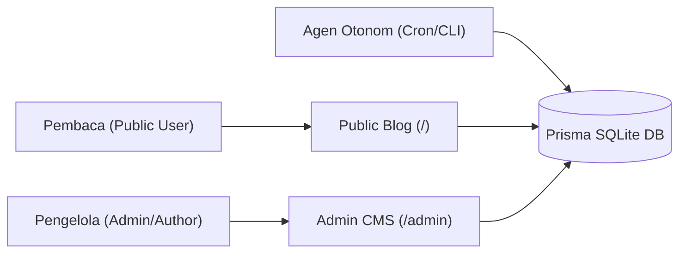
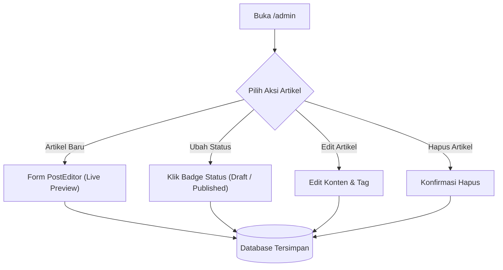

# Panduan Pengguna (User Guide) - Antigravity Multi-Agent Blog

Selamat datang di **Panduan Pengguna Antigravity Multi-Agent Blog**. Dokumen ini menyajikan instruksi lengkap mengenai cara menggunakan, mengelola, dan mengoperasikan aplikasi blog, baik dari perspektif pembaca umum maupun administrator/penulis blog.

---

## Daftar Isi
1. [Ikhtisar Aplikasi](#1-ikhtisar-aplikasi)
2. [Panduan Pembaca (Public Blog Interface)](#2-panduan-pembaca-public-blog-interface)
   - [Navigasi Beranda](#navigasi-beranda)
   - [Membaca Artikel](#membaca-artikel)
   - [Berpartisipasi dalam Kolom Komentar](#berpartisipasi-dalam-kolom-komentar)
3. [Panduan Administrator (Admin CMS Dashboard)](#3-panduan-administrator-admin-cms-dashboard)
   - [Mengakses Dashboard Admin](#mengakses-dashboard-admin)
   - [Manajemen Artikel (Post Management)](#manajemen-artikel-post-management)
   - [Editor Markdown & Live Preview](#editor-markdown--live-preview)
   - [Moderasi Komentar (Comment Moderation)](#moderasi-komentar-comment-moderation)
   - [Membalas Komentar sebagai Author](#membalas-komentar-sebagai-author)
4. [Panduan Agen Operasional Mandiri (Autonomous Agents)](#4-panduan-agen-operasional-mandiri-autonomous-agents)
   - [Content Creator Agent (Posting Harian)](#content-creator-agent-posting-harian)
   - [Comment Responder Agent (Auto-Reply & Moderasi)](#comment-responder-agent-auto-reply--moderasi)
   - [Penjadwalan Otomatis di Antigravity](#penjadwalan-otomatis-di-antigravity)
5. [Troubleshooting & FAQ](#5-troubleshooting--faq)

---

## 1. Ikhtisar Aplikasi

Aplikasi ini adalah platform blog modern berbasis **Next.js 15 App Router**, **React 19**, **Tailwind CSS**, dan **Prisma ORM**. Platform ini mengintegrasikan ekosistem agen AI otonom untuk rekayasa perangkat lunak dan operasional harian.



---

## 2. Panduan Pembaca (Public Blog Interface)

### Navigasi Beranda
- Buka alamat utama aplikasi: `http://localhost:3000/`.
- Di bagian atas, Anda akan menemukan **Navbar** dengan tautan navigasi ke **Beranda** dan tombol akses **Admin Hub**.
- **Hero Section** menampilkan pengantar blog dan topik utama seputar rekayasa perangkat lunak dan arsitektur AI.
- **Grid Artikel Terbaru** menampilkan daftar seluruh artikel yang telah dipublikasikan (`status: published`), lengkap dengan:
  - Label Tag/Kategori (misal: `#Next.js`, `#Multi-Agent AI`).
  - Tanggal publikasi terformat.
  - Estimasi waktu baca (*reading time*).
  - Ringkasan singkat (*excerpt*).

### Membaca Artikel
1. Klik judul artikel atau tombol **"Baca →"** pada kartu artikel untuk membuka halaman detail (`/posts/[slug]`).
2. Konten artikel disajikan menggunakan format tipografi elegan (*prose typography*) yang nyaman di mata dengan dukungan:
   - Judul hierarkis (H1, H2, H3).
   - Format teks tebal, miring, dan daftar poin.
   - Blok kode (*syntax highlighting*) untuk memudahkan pemahaman teknis.
3. Di bawah judul, terdapat informasi penulis (*Antigravity Editorial Agent*), tanggal terbit, dan estimasi waktu baca.

### Berpartisipasi dalam Kolom Komentar
Di bagian bawah setiap artikel, terdapat area **Diskusi**:
1. **Mengirim Komentar Baru**:
   - Masukkan **Nama Lengkap**.
   - Masukkan **Email** (email bersifat privat dan tidak akan ditampilkan ke publik).
   - Tulis komentar atau pertanyaan Anda pada kolom teks.
   - Klik tombol **"Kirim Komentar"**.
   - *Catatan Keamanan*: Komentar secara otomatis disaring terhadap script berbahaya (XSS) dan kata kunci spam.
2. **Melihat Balasan**:
   - Komentar yang dijawab oleh penulis atau agen asisten akan memiliki lencana khusus berwarna ungu: **🤖 Author Bot** atau **Bot**.
3. **Membalas Komentar Pembaca Lain**:
   - Klik tombol **"Balas"** pada komentar tertentu untuk membuat balasan bersarang (*nested reply*).

---

## 3. Panduan Administrator (Admin CMS Dashboard)

Dashboard CMS Admin adalah pusat kendali bagi pemilik blog untuk menulis, mengedit, mempublikasikan artikel, dan memoderasi interaksi komunitas pembaca.

### Mengakses Dashboard Admin
- Klik tautan **"Admin Hub"** di navigasi kanan atas pada navbar publik, atau langsung kunjungi:
  ```text
  http://localhost:3000/admin
  ```
- *Catatan Akses*: Rute ini dirancang untuk produksi internal lokal sehingga dapat langsung diakses tanpa form login yang rumit.

---

### Manajemen Artikel (Post Management)

Di halaman admin, pilih tab **"Manajemen Artikel"**:



#### A. Membuat Artikel Baru
1. Klik tombol **"+ Artikel Baru"** di sudut kanan atas.
2. Formulir editor artikel akan terbuka:
   - **Judul Artikel**: Masukkan judul lengkap (minimal 5 karakter).
   - **Slug URL**: Terisi secara otomatis berdasarkan judul (misal: `panduan-nextjs-15`). Anda juga dapat menyesuaikannya secara manual.
   - **Ringkasan (Excerpt)**: Tulis deskripsi 1–2 kalimat yang akan tampil pada kartu beranda.
   - **Gambar Sampul (Opsional)**: Masukkan URL gambar header jika tersedia.
   - **Tag / Kategori**: Ketikkan nama tag (misal: `React`, `TypeScript`) lalu tekan *Enter* atau klik ikon tambah. Tag akan tampil sebagai badge yang dapat dihapus.
   - **Status Publikasi**: Pilih antara **Draf** (hanya terlihat di admin) atau **Publikasikan** (langsung tayang di beranda publik).
   - **Konten Artikel (Markdown)**: Tulis isi artikel menggunakan sintaks Markdown.

#### B. Menggunakan Fitur Live Preview Markdown
- Pada area editor konten, Anda dapat memilih mode tampilan:
  - **Edit**: Menampilkan textarea penulisan markdown murni.
  - **Preview**: Menampilkan hasil render HTML secara langsung persis seperti yang akan dilihat pembaca.
  - **Split View**: Menampilkan editor di sisi kiri dan pratinjau langsung di sisi kanan secara *real-time*.

#### C. Mengubah Status Publikasi Instan (*Draft <-> Published*)
- Pada tabel daftar artikel, perhatikan kolom **Status**:
  - Badge Hijau **Dipublikasikan**: Artikel sedang tayang di blog publik.
  - Badge Kuning **Draf**: Artikel tersimpan namun disembunyikan dari pembaca umum.
- Cukup **klik pada badge status** tersebut untuk mengubah statusnya secara instan tanpa perlu membuka form edit.

#### D. Mengedit dan Menghapus Artikel
- **Edit**: Klik tombol ikon pensil pada baris artikel untuk memuat seluruh data ke formulir editor. Lakukan perubahan lalu klik **"Perbarui Artikel"**.
- **Hapus**: Klik tombol ikon tempat sampah. Sistem akan menampilkan dialog konfirmasi keamanan. Jika disetujui, artikel beserta komentar dan relasi tag-nya akan dihapus secara bersih dari database.

---

### Moderasi Komentar (Comment Moderation)

Pilih tab **"Moderasi Komentar"** di Dashboard Admin untuk memantau aktivitas diskusi pembaca.

#### A. Memfilter Berdasarkan Status
Gunakan tombol filter di bagian atas tabel:
- **Semua**: Menampilkan seluruh komentar yang pernah masuk.
- **Pending**: Komentar baru yang menunggu persetujuan admin.
- **Approved**: Komentar yang sudah lolos kurasi dan tampil di halaman artikel publik.
- **Spam**: Komentar yang terdeteksi atau ditandai sebagai spam/promosi terlarang (disembunyikan dari publik).

#### B. Tindakan Cepat (Quick Actions)
Pada setiap baris komentar, tersedia tombol aksi:
1. **Setujui (Approve)**: Mengubah status komentar menjadi `APPROVED` sehingga langsung tampil di bawah artikel terkait.
2. **Tandai Spam**: Mengubah status komentar menjadi `SPAM`. Komentar spam tidak akan dimuat pada halaman pembaca dan diabaikan oleh agen auto-reply.
3. **Hapus**: Menghapus rekaman komentar secara permanen dari basis data.

#### C. Membalas Komentar sebagai Author
1. Klik tombol **"Balas"** pada komentar yang ingin Anda tanggapi.
2. Modal **Balas Komentar Pembaca** akan muncul dengan rincian komentar pembaca dan judul artikel terkait.
3. Ketikkan balasan teknis atau apresiasi Anda.
4. Klik **"Kirim Balasan"**.
5. Sistem akan menyimpan tanggapan Anda dengan penanda `isAuthorReply: true`, sehingga pada halaman publik balasan tersebut otomatis memiliki lencana resmi **Author Bot**.

---

## 4. Panduan Agen Operasional Mandiri (Autonomous Agents)

Aplikasi dilengkapi dua agen AI yang dapat bekerja mandiri di latar belakang:

### Content Creator Agent (Posting Harian)
- **Fungsi**: Membaca ide artikel dari `content/backlog.json`, menyusun draf komprehensif, memeriksa kualitas redaksional (panjang kata, struktur H1–H3, contoh kode), dan mempublikasikannya langsung ke database.
- **Menjalankan Manual via CLI**:
  ```powershell
  npm.cmd run agent:content
  ```
- **Menambahkan Topik ke Backlog**:
  Buka berkas `content/backlog.json` dan tambahkan objek baru dengan status `"READY"`:
  ```json
  {
    "id": "topic-4",
    "title": "Praktik Terbaik Pengamanan API dengan Zod dan Rate Limiting",
    "category": "Web Security",
    "tags": ["Security", "Zod", "NodeJS"],
    "targetAudience": "Backend Developer",
    "keyTakeaways": [
      "Pola sanitasi masukan string",
      "Pencegahan payload injection",
      "Implementasi rate limiting sederhana"
    ],
    "status": "READY"
  }
  ```

### Comment Responder Agent (Auto-Reply & Moderasi)
- **Fungsi**: Memindai komentar yang disetujui namun belum memiliki balasan author, menganalisis isi pertanyaan pembaca, dan membuat balasan kontekstual secara otomatis.
- **Menjalankan Manual via CLI**:
  ```powershell
  npm.cmd run agent:comments
  ```

### Penjadwalan Otomatis di Antigravity
Jika Anda menggunakan Google Antigravity, Anda dapat menjadwalkan kedua agen tersebut agar berjalan otomatis secara berkala menggunakan slash command `/schedule`:
- **Penjadwalan Konten Harian (Setiap Hari Pukul 08:00 WIB)**:
  ```text
  /schedule CronExpression="0 8 * * *" Prompt="Jalankan npm.cmd run agent:content lalu laporkan ringkasan artikel baru yang dibuat"
  ```
- **Pemeriksaan & Balasan Komentar Berkala (Setiap Jam)**:
  ```text
  /schedule CronExpression="0 * * * *" Prompt="Jalankan npm.cmd run agent:comments untuk memeriksa dan menjawab komentar pembaca"
  ```

---

## 5. Troubleshooting & FAQ

### Q1: Database SQLite saya terkunci (*database is locked*) saat pengujian?
**Penyebab**: SQLite membatasi operasi tulis konkuren dalam waktu yang bersamaan.  
**Solusi**: Pastikan tidak ada skrip CLI yang sedang berjalan saat menjalankan test suite. Skrip pengujian telah dioptimalkan untuk menutup koneksi Prisma secara teratur setelah eksekusi selesai.

### Q2: Mengapa komentar baru saya tidak langsung muncul di artikel publik?
**Penyebab**: Jika komentar mengandung kata yang mencurigakan, status komentar akan otomatis ditetapkan sebagai `PENDING` atau `SPAM`.  
**Solusi**: Buka `http://localhost:3000/admin`, pilih tab **Moderasi Komentar**, lalu klik tombol **Setujui** pada komentar tersebut.

### Q3: Bagaimana cara mengubah basis data ke PostgreSQL?
1. Buka berkas `prisma/schema.prisma`.
2. Ubah blok datasource:
   ```prisma
   datasource db {
     provider = "postgresql"
     url      = env("DATABASE_URL")
   }
   ```
3. Sesuaikan variabel `DATABASE_URL` pada berkas `.env` dengan kredensial PostgreSQL Anda (misalnya PostgreSQL di Laragon atau Supabase/Neon).
4. Jalankan perintah migrasi:
   ```powershell
   npm.cmd run db:push
   ```

### Q4: Bagaimana cara menjalankan pengujian mandiri (*self-test*)?
Jalankan perintah berikut pada terminal PowerShell:
```powershell
npm.cmd run test
```
Seluruh 104 pengujian otomatis akan diverifikasi dalam hitungan detik.
