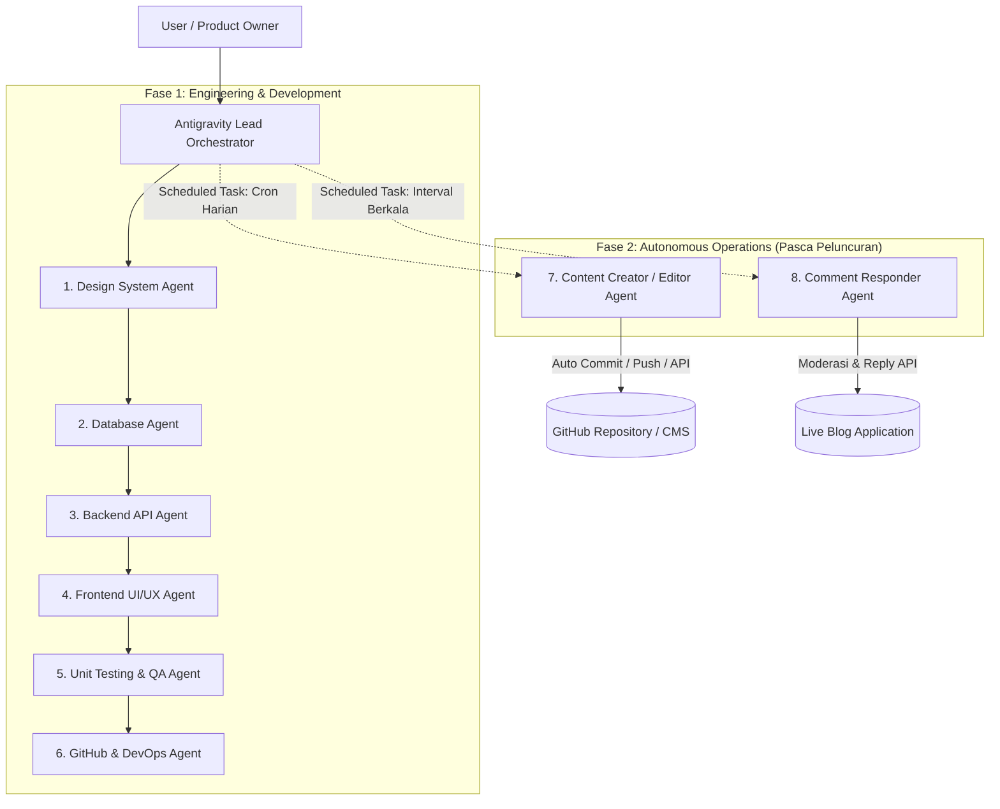

# Panduan Arsitektur & Implementasi Multi-Agent Blog dengan Google Antigravity

Dokumen ini merangkum rancangan sistem, pembagian tugas peran agen, alur kerja bertahap, serta strategi operasional mandiri (*autonomous operations*) untuk membangun dan mengelola aplikasi blog menggunakan ekosistem multi-agent di Google Antigravity.

---

## 1. Arsitektur Alur Kerja Multi-Agent

---

## 2. Rincian Peran & Spesifikasi Agen

### A. Fase Rekayasa & Pengembangan (Engineering Lifecycle)

#### 1. Design System Agent
* **Tujuan**: Membangun fondasi estetika visual, konsistensi tema, dan aksesibilitas antarmuka pengguna.
* **Tanggung Jawab Utama**:
  * Menentukan token desain: warna primer/aksen, light & dark mode, skala tipografi yang optimal untuk pembacaan teks panjang (*prose readability*), serta grid spacing.
  * Menyiapkan komponen UI atomik dan molekuler (Button, Card, Badge, Modal, Navigation Header, Footer, Table of Contents).
* **Deliverable**: `tailwind.config.js` / variabel CSS, direktori pustaka komponen (`src/components/ui/*`).

#### 2. Database Agent
* **Tujuan**: Merancang skema penyimpanan data yang efisien, ternormalisasi, dan teroptimasi untuk performa baca (*read-heavy*).
* **Tanggung Jawab Utama**:
  * Merancang Entity-Relationship Diagram (ERD):
    * `User` (Author, Admin, Contributor)
    * `Post` (Title, Slug, Excerpt, Content Markdown/HTML, CoverImage, PublishedAt, Status [Draft, Review, Published])
    * `Comment` (Content, AuthorName, AuthorEmail, Status [Pending, Approved, Spam], PostId, ParentId untuk threading)
    * `Tag` / `Category` (Relasi many-to-many ke Post)
  * Menyiapkan migration script dan data seeding awal untuk kebutuhan pengujian.
* **Deliverable**: Skema ORM (`prisma/schema.prisma` atau Drizzle schema), script migrasi, dan seed data.

#### 3. Backend API Agent
* **Tujuan**: Membangun logika bisnis, endpoint API, dan pengamanan layer server.
* **Tanggung Jawab Utama**:
  * Membuat endpoint REST / Server Actions untuk CRUD Post, Filter Kategori, Pagination, dan Pencarian.
  * Mengembangkan endpoint pengiriman komentar beserta mekanisme anti-spam (honeypot, rate limiting).
  * Validasi payload secara ketat menggunakan pustaka seperti Zod.
  * Menyediakan webhook / internal secure API untuk integrasi agen operasional (Content Writer & Comment Responder).
* **Deliverable**: Route handlers (`src/app/api/*`), schema validasi (`src/lib/validations/*`), dan services layer.

#### 4. Frontend UI/UX Agent
* **Tujuan**: Mengimplementasikan antarmuka interaktif yang responsif, cepat, dan SEO-friendly.
* **Tanggung Jawab Utama**:
  * Halaman Beranda (Daftar artikel, featured post, filter tag/kategori, pagination/infinite loading).
  * Halaman Detail Artikel (Render Markdown/MDX dengan syntax highlighting untuk blok kode, perkiraan waktu baca, tombol share).
  * Area Diskusi / Komentar (Form input responsif, nested thread replies, live feedback state).
  * Admin / Review Dashboard sederhana untuk menyetujui draf artikel dan moderasi komentar.
* **Deliverable**: Halaman aplikasi (`src/app/*`), integrasi client-server components, dan optimalisasi Core Web Vitals.

#### 5. Unit Testing & QA Agent
* **Tujuan**: Menjamin keandalan perangkat lunak bebas regresi sebelum perilisan.
* **Tanggung Jawab Utama**:
  * Menguji logika backend: validasi input Zod, otorisasi, penanganan komentar bersarang, dan sanitasi HTML (mencegah celah XSS).
  * Menguji rendering komponen frontend menggunakan Vitest / React Testing Library.
  * Melakukan verifikasi endpoint API dengan mock request.
* **Deliverable**: Berkas pengujian (`__tests__/*`), coverage report, dan script `npm test`.

#### 6. GitHub & DevOps Deployment Agent
* **Tujuan**: Mengotomatisasi siklus rilis dan integrasi berkelanjutan (*CI/CD*).
* **Tanggung Jawab Utama**:
  * Inisialisasi Git repository lokal dan konfigurasi aturan `.gitignore`.
  * Membuat remote repository di GitHub menggunakan GitHub CLI (`gh`).
  * Menyiapkan GitHub Actions workflow (`.github/workflows/ci.yml`) untuk menjalankan lint, type-check, dan unit test otomatis pada setiap push atau PR.
  * Konfigurasi continuous deployment (CD) ke platform hosting (Vercel, Cloudflare Pages, atau Railway).
* **Deliverable**: Alur CI/CD `.github/workflows/`, repositori GitHub terhubung, dan URL deploy aktif.

---

### B. Fase Operasional Mandiri Pasca Rilis (Autonomous Operations)

#### 7. Content Creator / Writer / Editor Agent (Daily Posting)
* **Tujuan**: Menjalankan strategi konten harian secara otomatis tanpa intervensi manual penuh.
* **Mekanisme Kerja**:
  1. **Ideation**: Membaca antrean topik yang tersedia dari `content/backlog.json` atau mengekstrak ide tren teknologi terkini.
  2. **Drafting (Writer)**: Menulis artikel 800–1.200 kata dalam format Markdown/MDX dengan struktur rapi (H1, H2, H3, poin kunci, dan contoh kode kontekstual).
  3. **SEO & Metadata**: Melengkapi YAML Frontmatter (title, slug, excerpt, tags, canonical URL, estimasi reading time).
  4. **Editorial Review (Editor)**: Mengoreksi gaya bahasa, memeriksa akurasi teknis, menghapus redudansi, dan memastikan tidak ada elemen clickbait berlebihan.
  5. **Publishing**: Menyimpan artikel baru secara otomatis ke direktori postingan atau memicu PR baru ke branch utama melalui Git scheduler.
* **Frekuensi**: Terjadwal setiap hari (contoh: jam 08:00 WIB) menggunakan Antigravity task scheduling.

#### 8. Comment Responder & Moderation Agent
* **Tujuan**: Membangun interaksi aktif dengan pembaca sekaligus menjaga area komentar tetap bersih dan aman.
* **Mekanisme Kerja**:
  1. **Monitoring & Moderasi**: Memindai komentar baru yang masuk. Menolak tautan mencurigakan (*phishing*), kata-kata kasar, atau spam.
  2. **Analisis Konteks**: Membaca isi artikel terkait untuk memahami pertanyaan yang diajukan pembaca.
  3. **Auto-Reply**: Menyusun jawaban yang ramah, sopan, dan berbobot teknis atas nama akun "Author Bot" atau asisten blog.
  4. **Eskalasi Manual**: Menandai pertanyaan yang sangat spesifik atau bernada komplain untuk ditinjau langsung oleh pemilik blog.
* **Frekuensi**: Dijalankan berkala (misal polling setiap 1–2 jam atau di-trigger melalui webhook).

---

## 3. Alur Eksekusi Bertahap di Antigravity

| Langkah | Agen Bertanggung Jawab | Perintah / Metodologi di Antigravity | Output Kunci |
| :--- | :--- | :--- | :--- |
| **0. Perencanaan** | Lead Orchestrator | `/plan` | Roadmap dan milestone eksekusi proyek. |
| **1. Desain Sistem** | Design System Agent | `invoke_subagent` (Role: Design System) | Token Tailwind, UI base components. |
| **2. Basis Data** | Database Agent | `invoke_subagent` (Role: Database Architect) | Prisma/Drizzle Schema, Seeders, Migrations. |
| **3. API & Logika** | Backend API Agent | `invoke_subagent` (Role: Backend Engineer) | API Routes, Zod validators, Sanitizer. |
| **4. Antarmuka** | Frontend UI/UX Agent | `invoke_subagent` (Role: Frontend Developer) | Halaman Blog, Markdown Viewer, Komentar. |
| **5. Pengujian** | Unit Testing Agent | `invoke_subagent` (Role: QA Tester) | Test suite Vitest, integrasi unit tests. |
| **6. Deploy & Git** | DevOps Agent | `run_command` (`gh`, `git`) | GitHub Repo, CI/CD Actions, Production URL. |
| **7. Konten Harian**| Content Creator Agent| `/schedule` (Cron: `0 8 * * *`) | Markdown posts baru setiap hari. |
| **8. Komentar** | Comment Responder | `/schedule` (Cron: `0 */2 * * *`) | Moderasi otomatis dan respons pembaca. |

---

## 4. Rekomendasi Fitur Antigravity

- **/plan**: Selalu awali proyek dengan menyusun rencana terperinci untuk menyelaraskan dependensi antar-agen (misal: Backend Agent membutuhkan schema dari Database Agent terlebih dahulu).
- **/teamwork**: Aktifkan mode kolaboratif untuk mendistribusikan pekerjaan independen (misal: Unit Testing Agent dan Frontend Agent dapat mulai bekerja setelah kontrak API Backend selesai).
- **/schedule**: Konfigurasikan pekerjaan berulang untuk agen operasional harian (Content Creator & Comment Responder) agar berjalan tanpa perlu dipicu secara manual.
- **Artifacts**: Gunakan artifacts Antigravity untuk menyimpan checklist kemajuan tugas, dokumentasi API, dan log audit publikasi konten.
