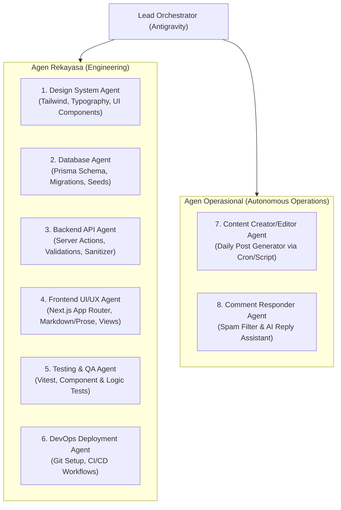

# Implementation Plan: Aplikasi Blog Berbasis Multi-Agent di Antigravity

Membangun aplikasi blog full-stack modern dan modular dari awal menggunakan orkestrasi **Multi-Agent di Google Antigravity**. Sistem ini mencakup 6 agen rekayasa (Engineering Lifecycle) dan 2 agen operasional mandiri (Autonomous Operations) untuk pembuatan konten harian dan penjawab komentar otomatis.

---

## User Review Required

> [!IMPORTANT]
> **Pilihan Basis Data Default**: Rencana ini mengusulkan **Prisma ORM dengan SQLite** untuk tahap awal agar aplikasi bersifat *zero-config* dan langsung dapat dijalankan di mesin lokal tanpa perlu konfigurasi server database eksternal. Skema Prisma dirancang agar 100% kompatibel dan mudah dialihkan ke PostgreSQL (tersedia di Laragon pengguna) dengan mengubah 1 baris *provider*.
>
> **GitHub Deployment**: Karena `gh` (GitHub CLI) belum terpasang di sistem, agen deployment akan menginisialisasi Git lokal, membuat `.github/workflows/ci.yml`, dan menyiapkan remote URL standar menggunakan `git remote add origin <URL-Repo-User>`.

---

## Open Questions

1. **Tema Konten Default**: Apakah ada topik utama tertentu untuk *Content Creator Agent* (misalnya: *Web Development & AI*, *Tutorial Pemrograman*, *Teknologi Umum*)? *(Default yang diusulkan: Software Engineering & Artificial Intelligence)*.
2. **Koneksi Database**: Apakah Anda ingin langsung menggunakan PostgreSQL lokal dari Laragon atau menggunakan SQLite terlebih dahulu?

---

## Arsitektur Sistem & Spesifikasi Agen



---

## Proposed Changes

### Tech Stack
- **Framework**: Next.js 15 (App Router, Server Components, Server Actions)
- **Styling**: Tailwind CSS + `@tailwindcss/typography` (optimal untuk artikel blog)
- **Database / ORM**: Prisma ORM dengan SQLite (bisa dialihkan ke PostgreSQL)
- **Validasi & Keamanan**: Zod + DOMPurify / sanitize-html
- **Testing**: Vitest + React Testing Library
- **Automation / Agents**: TypeScript CLI scripts (`scripts/daily-content.ts`, `scripts/reply-comments.ts`) + definisi subagent di `AGENTS.md`

---

### Struktur Proyek yang Akan Dibangun

```
d:/c/blog/
├── .github/
│   └── workflows/
│       └── ci.yml                 # CI pipeline (lint, type-check, vitest)
├── content/
│   ├── backlog.json               # Bank ide topik artikel untuk Content Agent
│   └── posts/                     # Direktori artikel markdown yang diproduksi
├── prisma/
│   ├── schema.prisma              # Schema Post, Comment, Tag, User
│   └── seed.ts                    # Sample data
├── src/
│   ├── app/
│   │   ├── layout.tsx             # Root layout dengan theme & font
│   │   ├── page.tsx               # Homepage: daftar artikel & filter kategori
│   │   ├── posts/
│   │   │   └── [slug]/
│   │   │       └── page.tsx       # Detail artikel & form komentar
│   │   ├── api/
│   │   │   ├── posts/route.ts     # Post API endpoint
│   │   │   └── comments/route.ts  # Comment submit & moderation endpoint
│   │   └── globals.css
│   ├── components/
│   │   ├── ui/                    # Komponen atomik (Button, Badge, Card, Input)
│   │   └── blog/                  # Komponen fitur (PostCard, CommentSection, ShareBar)
│   ├── lib/
│   │   ├── db.ts                  # Prisma Client instance
│   │   ├── validations.ts         # Zod schemas (Comment, Post)
│   │   └── markdown.ts            # Markdown parser & reading time calculation
├── scripts/
│   ├── daily-content.ts           # Skrip eksekusi agen Content Creator/Editor
│   └── reply-comments.ts          # Skrip eksekusi agen Comment Responder
├── tests/
│   ├── validations.test.ts        # Unit test schema & anti-XSS
│   └── markdown.test.ts           # Unit test kalkulasi baca & parser
├── AGENTS.md                      # Dokumentasi & prompt template subagents
├── package.json
├── tailwind.config.ts
└── tsconfig.json
```

---

## Rincian Perubahan File

### 1. Inisialisasi & Konfigurasi Dasar
#### [NEW] `package.json`
- Menetapkan dependensi: `next`, `react`, `react-dom`, `@prisma/client`, `zod`, `clsx`, `tailwind-merge`, `lucide-react`, `marked` / `gray-matter`.
- DevDependencies: `typescript`, `tailwindcss`, `@tailwindcss/typography`, `prisma`, `vitest`, `@testing-library/react`.
- Scripts: `dev`, `build`, `start`, `test`, `db:push`, `db:seed`, `agent:content`, `agent:comments`.

#### [NEW] `tailwind.config.ts` & `src/app/globals.css`
- Konfigurasi warna, dark mode (`class`), dan plugin `@tailwindcss/typography` untuk rendering konten artikel elegan.

---

### 2. Database & Data Model
#### [NEW] `prisma/schema.prisma`
- Model `Post`: `id`, `title`, `slug` (unique indexed), `excerpt`, `content` (Markdown), `coverImage`, `published`, `publishedAt`, `createdAt`, `updatedAt`, `tags` (relasi many-to-many), `comments` (relasi one-to-many).
- Model `Comment`: `id`, `postId`, `authorName`, `authorEmail`, `content`, `status` (`APPROVED`, `PENDING`, `SPAM`), `parentId` (opsional untuk nested reply), `isAuthorReply` (boolean, penanda jawaban bot/author), `createdAt`.
- Model `Tag`: `id`, `name`, `slug` (unique).

#### [NEW] `prisma/seed.ts`
- Seeding 3 artikel awal berkualitas tinggi dan 3 komentar contoh (termasuk contoh balasan).

---

### 3. Backend & Logika Bisnis
#### [NEW] `src/lib/validations.ts`
- Schema Zod untuk validasi input komentar: memastikan panjang karakter sesuai, email valid, dan tidak ada tag script jahat.
- Schema Zod untuk postingan baru.

#### [NEW] `src/lib/markdown.ts`
- Parsing Markdown ke HTML aman, penambahan estimasi waktu membaca (*reading time*), dan ekstraksi metadata Frontmatter.

#### [NEW] `src/app/api/comments/route.ts`
- Endpoint untuk menerima komentar publik dengan verifikasi Zod, filter kata terlarang/spam, dan status `APPROVED` atau `PENDING`.

---

### 4. Frontend & Desain UI/UX
#### [NEW] `src/components/ui/*`
- `button.tsx`, `card.tsx`, `badge.tsx`, `input.tsx`, `textarea.tsx`.

#### [NEW] `src/components/blog/*`
- `PostCard.tsx`: Tampilan cuplikan postingan, thumbnail, badge tag, dan metadata tanggal/reading time.
- `CommentSection.tsx`: Form pengiriman komentar interaktif, penanda badge khusus `Author Bot / Admin`, dan thread balasan bersarang (*nested replies*).
- `Navbar.tsx` & `Footer.tsx`: Navigasi responsif dengan toggle mode gelap.

#### [NEW] `src/app/page.tsx` & `src/app/posts/[slug]/page.tsx`
- Halaman beranda responsif dengan filter pencarian dan tag.
- Halaman baca artikel dengan format tipografi rapi, breadcrumb, dan area komentar.

---

### 5. Otomasi Agen Operasional (Autonomous Scripts & Prompts)
#### [NEW] `content/backlog.json`
- Daftar antrean ide topik, outline, dan target audiens untuk diproses oleh *Content Creator Agent*.

#### [NEW] `scripts/daily-content.ts`
- Skrip otomasi untuk *Content Creator / Editor Agent*:
  1. Mengambil 1 topik dari `backlog.json`.
  2. Menghasilkan konten artikel lengkap (Markdown + Frontmatter).
  3. Memvalidasi struktur (H1, H2, kata kunci, panjang > 800 kata).
  4. Menyimpan langsung ke database Prisma atau file `.md` di `content/posts/`.

#### [NEW] `scripts/reply-comments.ts`
- Skrip otomasi untuk *Comment Responder Agent*:
  1. Melakukan query komentar baru yang belum dibalas atau berstatus `PENDING`.
  2. Memeriksa indikasi spam; jika spam, tandai status sebagai `SPAM`.
  3. Menghasilkan balasan kontekstual berdasarkan konten artikel.
  4. Menyimpan balasan dengan flag `isAuthorReply: true`.

#### [NEW] `AGENTS.md`
- Panduan instruksi sistem (*system prompts*) untuk masing-masing agen, format komunikasi antar agen, dan panduan menjalankan scheduled task di Antigravity.

---

### 6. DevOps & Deployment
#### [NEW] `.github/workflows/ci.yml`
- Workflow GitHub Actions: menjalankan checkout, setup Node.js v24, install dependencies via `npm.cmd`, type-check (`tsc --noEmit`), dan menjalankan unit test Vitest.

---

## Verification Plan

### Automated Tests
1. **Unit Test Validasi & Keamanan**:
   ```powershell
   npm.cmd run test
   ```
   *Memverifikasi Zod schema mendeteksi input berbahaya, lolos validasi format email, dan mencegah string kosong.*
2. **Type-Checking & Build Test**:
   ```powershell
   npm.cmd run build
   ```
   *Memastikan tidak ada error TypeScript dan seluruh halaman Server/Client Components berhasil di-compile.*

### Manual & Operasional Verification
1. **Verifikasi Database & Seeding**:
   - Jalankan `npx.cmd prisma db push` dan `npx.cmd ts-node prisma/seed.ts` (atau via tsx/npm script).
   - Pastikan artikel dan komentar contoh tampil di database.
2. **Verifikasi Tampilan UI**:
   - Jalankan `npm.cmd run dev` dan buka `http://localhost:3000`.
   - Periksa responsivitas beranda, halaman detail artikel, dark mode, dan form kirim komentar.
3. **Verifikasi Agen Konten & Komentar**:
   - Jalankan `npm.cmd run agent:content` -> Verifikasi artikel baru berhasil di-generate dan muncul di daftar postingan.
   - Jalankan `npm.cmd run agent:comments` -> Verifikasi komentar yang belum dibalas mendapat tanggapan otomatis dengan badge bot.
